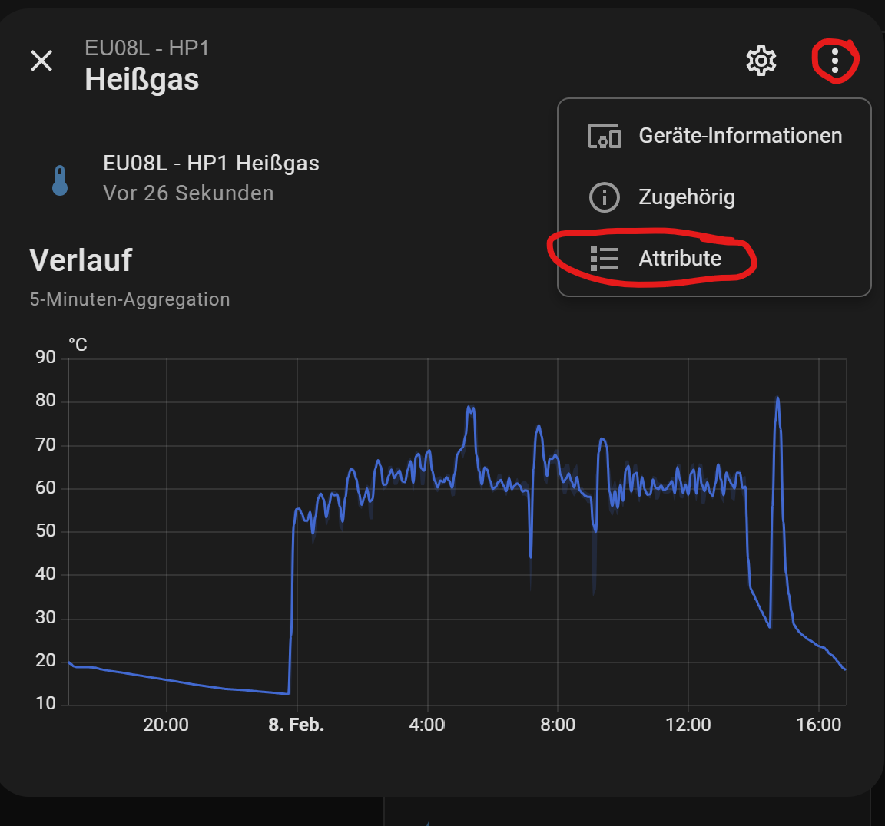

# Attribute auslesen

*Zuletzt geändert am 17.10.2026*

Attribute sind Zusatzinformationen einer Entität neben ihrem Wert, z. B. Einheit, Geräteklasse oder Anzeigename.

!!! info "Seit Version 3.5 kein Attribut `register` mehr"
    Bis Version 2.x trug jeder Sensor ein Attribut `register` mit seiner Modbus-Adresse. In Version 3.5 gibt es dieses Attribut nicht mehr. Die Register-Adresse eines Sensors finden Sie in der [Sensorübersicht für Entwickler](../Entwickler/sensoren-uebersicht.md): Dort steht die Adresse relativ zum Modul, die tatsächliche Adresse ergibt sich aus der Basisadresse des Moduls (z. B. HP1 = 1000, HC1 = 5000).

    Das einzige eigene Attribut der Integration ist `applied_offset` an den Gesamtzählern: der Offset aus der `lambda_wp_config.yaml`, der im Wert bereits enthalten ist (siehe [Offsets](offsets.md)).

## Über den Sensor

<div style="display: flex; gap: 20px; align-items: flex-start; margin: 20px 0; flex-wrap: wrap;">
  <div style="flex: 0 0 50%; min-width: 300px;">
    
  </div>
  <div style="flex: 1; min-width: 300px;">
    <p>Die Detailansicht des Sensors öffnen und über die „⋮“ auf <strong>Attribute</strong> klicken.</p>
    <p>Dann werden die Attribute sichtbar.</p>
    
  </div>
</div>

## Über die Entwicklerwerkzeuge

Unter **Entwicklerwerkzeuge** → **Zustände** den Sensor über seinen Namen suchen. In der rechten Spalte stehen alle Attribute.


## Über ein Jinja2 Template

Unter **Entwicklerwerkzeuge** → **Template** eingeben:

```jinja2


Zustand: {{ states[entity_id].state }}

- {{ k }}: {{ states[entity_id].attributes[k] }}


Sensor nicht verfügbar.

```
