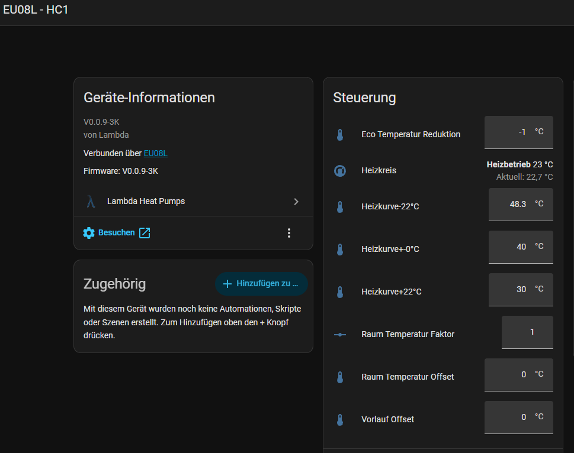

# Heizkreis Steuerung

*Zuletzt geändert am 30.10.2026*

Die Integration berechnet die Soll-Vorlauftemperatur des Heizkreises beim Heizen. Dafür braucht sie die Heizkurve Ihrer Lambda. Die Lambda stellt diese Werte nicht über Modbus bereit. Sie müssen deshalb am Display der Lambda abgelesen und in Home Assistant eingetragen werden.

  

    
  

  

    
Die Entitäten der Steuerung eines Heizkreises sind:

    <ul>
      <li><strong>Heizkurve-22°C, Heizkurve+-0°C, Heizkurve+22°C</strong>: die drei Stützpunkte der Heizkurve</li>
      <li><strong>Eco Temperatur Reduktion</strong>: Absenkung im Eco-Betrieb</li>
      <li><strong>Raum Temperatur Faktor, Raum Temperatur Offset</strong>: nur sichtbar, wenn ein Raumthermometer im Heizkreis aktiv ist</li>
      <li><strong>Vorlauf Offset</strong>: Korrektur der Vorlauftemperatur</li>
    </ul>
  

## Welche Werte von Hand übertragen werden

Alle Werte außer dem **Vorlauf Offset** müssen am Display der Lambda abgelesen und in Home Assistant eingetragen werden:

| Entität | Wo steht der Wert an der Lambda | Übertragung |
|---|---|---|
| Heizkurve-22°C, Heizkurve+-0°C, Heizkurve+22°C | Heizkurve des Heizkreises | von Hand nach Home Assistant |
| Eco Temperatur Reduktion | Eco-Einstellungen des Heizkreises | von Hand nach Home Assistant |
| Raum Temperatur Faktor, Raum Temperatur Offset | Raumthermostat-Einstellungen des Heizkreises | von Hand nach Home Assistant |
| Vorlauf Offset | Vorlauf-Offset des Heizkreises | wird von der Integration aus der Lambda gelesen und beim Ändern in Home Assistant an die Lambda geschrieben |

Ab Werk zeigen die Heizkurven-Werte in Home Assistant die Standardwerte der Integration (48,3 / 39,0 / 32,0 °C). Diese stimmen in der Regel nicht mit Ihrer Anlage überein. Tragen Sie daher die Werte Ihres Displays ein.

!!! warning "Nach jeder Änderung an der Heizkurve am Display nachziehen"
    Ändern Sie die Heizkurve oder die Eco-Absenkung am Display der Lambda, müssen Sie die Werte in Home Assistant ebenfalls anpassen. Die Integration erkennt Änderungen am Display nicht.

## Wofür die Werte benötigt werden

Der Sensor **Heizkurve Vorlauf ber.** (`heating_curve_flow_line_temperature_calc`) berechnet daraus die Soll-Vorlauftemperatur beim Heizen:

1. Die Außentemperatur wird auf der Heizkurve zwischen den Stützpunkten linear interpoliert.
2. Der Vorlauf Offset wird addiert.
3. Im Eco-Betrieb wird die Eco Temperatur Reduktion addiert (ein negativer Wert senkt die Vorlauftemperatur).
4. Ist ein Raumthermometer aktiv, wird die Raumkorrektur addiert.

Der Sensor dient als Vergleichswert. Die Lambda regelt weiterhin mit ihrer eigenen Heizkurve. Den tatsächlichen Vorlauf-Sollwert der Lambda zeigt der Sensor `hcX_target_temp_flow_line` (Firmware ab V0.0.5-3K) bzw. `hcX_flow_line_temperature_setpoint` (ältere Firmware). Weicht dieser dauerhaft vom berechneten Wert ab, stimmen die Werte in Home Assistant nicht mit dem Display überein.

## Vorlage: Heizkurven-Card

Eine fertige Dashboard-Karte, die die Heizkurve und die Werte übersichtlich darstellt, finden Sie hier:
[Lambda Heizkurven Card](https://guidojeuken-6512.github.io/lambda_heat_pumps/Vorlagen/Lambda_heizkurve_card/)

## Weitere Informationen

- [Heizkurve / berechnete Vorlauftemperatur](heizkurve.md)
- [Raumthermometer](raumthermometer.md)
- [Initiale Konfiguration](initiale-konfiguration.md)
