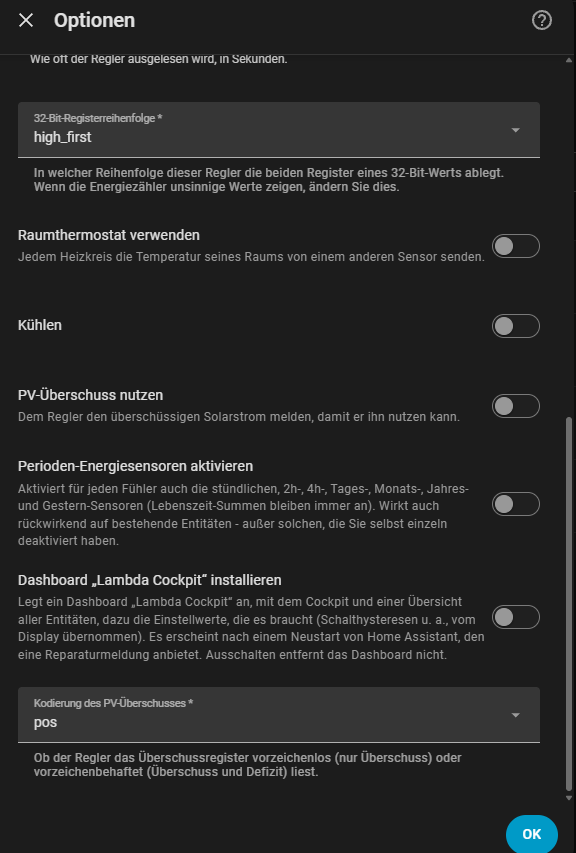
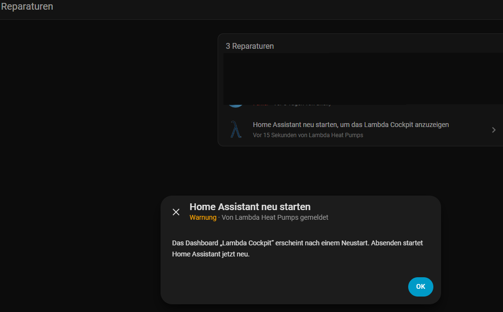

# Lambda Cockpit

*Zuletzt geändert am 14.11.2026*

Ab Version 3.7.0 bringt die Integration ein fertiges Dashboard mit: das **Lambda Cockpit**. Es zeigt die Wärmepumpe auf einer Seite, mit animierter Außeneinheit, Warmwasser, Puffer und Heizkreis im Stil der Lambda-Regelung, Heizkurve mit Wärmefahrplan, Schaltpunkten, Laufzeiten, Energie und Jahresarbeitszahl. Dazu kommt eine Übersicht aller Entitäten der Integration, sortiert nach Modulen und mit einer Erklärung zu jedem Wert.

Die Texte erscheinen auf Deutsch oder Englisch, je nach Sprache Ihres Benutzerprofils in Home Assistant.

## Dashboard installieren

1. **Einstellungen** → **Geräte & Dienste** → Lambda → **Konfigurieren**.
2. **Dashboard „Lambda Cockpit“ installieren** einschalten und **Absenden**.

    

3. Die Integration legt das Dashboard an. Kurz danach erscheint unter **Einstellungen** → **Reparaturen** der Eintrag **„Home Assistant neu starten, um das Lambda Cockpit anzuzeigen“** (Warnung, gemeldet von Lambda Heat Pumps).
4. Den Eintrag öffnen. Der Dialog **„Home Assistant neu starten“** erklärt, dass das Dashboard erst nach einem Neustart erscheint. Mit **OK** startet Home Assistant sofort neu.

    

5. Nach dem Neustart ist das Dashboard eingebunden: **Lambda Cockpit** steht in der Seitenleiste, und der Reparatur-Eintrag ist verschwunden.
6. Fehlt der Eintrag in der Seitenleiste oder meldet das Dashboard statt der Karten einen Fehler zu `lambda-cockpit-card`, die Seite im Browser neu laden (F5; in der Companion App die Seite herunterziehen bzw. den Frontend-Cache zurücksetzen). Der Browser zeigt dann noch den Stand von vor dem Neustart.

!!! note "Warum ein Neustart?"
    Home Assistant liest die Liste der Dashboards nur beim Start. Ein neu angelegtes Dashboard erscheint deshalb erst danach. Spätere Aktualisierungen des Dashboards durch die Integration brauchen keinen Neustart mehr.

Das Dashboard können Sie wie jedes andere bearbeiten. Ändert eine neue Version der Integration den Aufbau, wird es einmal neu geschrieben; eigene Änderungen gehen dann verloren. Wer viel anpasst, kopiert sich die Karten besser in ein eigenes Dashboard.

### Nach einem Update der Integration

- **Die Karten sind sofort aktuell.** Der Browser lädt nach dem Update die neue Fassung von Cockpit-, Heizkreis- und Entitäten-Karte, auch in einem eigenen Dashboard. Neue Anzeigen innerhalb der Karten sind damit ohne Zutun da. Fehlen sie, die Seite im Browser neu laden.
- **Der Aufbau des Dashboards bleibt.** Ansichten, Reiter und die eingetragenen Entitäten schreibt die Integration nur neu, wenn eine Version den Aufbau ändert (dann einmalig beim Start) oder wenn eine Reparaturmeldung es anbietet und Sie sie absenden, z. B. für weitere Heizkreise.
- **Selbst neu schreiben:** Die Aktion `lambda_heat_pumps.generate_dashboard` (Entwicklerwerkzeuge → Aktionen) schreibt das Dashboard jederzeit komplett neu, mit dem Aufbau der installierten Version. Eigene Änderungen am Dashboard „Lambda Cockpit“ gehen dabei verloren. Ist die Option „Lambda Cockpit“ ausgeschaltet, entfernt die Integration das so erzeugte Dashboard beim nächsten Start wieder.

## Dashboard entfernen

Schalten Sie **Dashboard „Lambda Cockpit“ installieren** unter **Konfigurieren** wieder aus und **Absenden**. Die Integration entfernt dann das Dashboard und die Einstellwerte, die nur das Cockpit brauchte. Ein Neustart ist dafür nicht nötig; steht der Eintrag noch in der Seitenleiste, die Seite im Browser neu laden.

!!! warning "Eigene Änderungen gehen verloren"
    Haben Sie das Dashboard angepasst, sind diese Änderungen nach dem Ausschalten weg. Wer etwas behalten will, kopiert die Karten vorher in ein eigenes Dashboard.

Ein von Hand gelöschtes Dashboard (**Einstellungen** → **Dashboards**) stellt die Aktion `lambda_heat_pumps.generate_dashboard` (Entwicklerwerkzeuge → Aktionen) wieder her.

## Was die Integration dafür anlegt

Mit der Option entstehen zusätzlich **Einstellwerte**, die das Cockpit für die Schaltpunkte braucht. Die Lambda stellt sie nicht per Modbus bereit, sie sind eine **Kopie** der Werte aus dem Lambda-Display. Tragen Sie sie einmal ein (Gerät → **Konfiguration**):

| Gerät | Einstellung |
|---|---|
| Boiler | Warmwasser Einschalthysterese, Ausschalthysterese, maximale Solltemperatur |
| Puffer | Einschalthysterese bei 25 °C und bei 50 °C, Ausschalthysterese, Solltemperaturoffset Heizbetrieb |
| Heizkreis | Einschalthysterese, Ausschalthysterese, Temperaturspreizung, Heizgrenze Außentemperatur, maximale Vorlauftemperatur |

Eine Änderung dieser Werte verstellt die Lambda nicht. Ändern Sie sie bei Bedarf in der Lambda selbst mit.

Solange diese Werte nicht mit dem Display abgeglichen sind, stimmen die Schaltpunkte nicht. Die Kachel **Schaltpunkte aktuell** erinnert deshalb daran. Den Hinweis können Sie nach dem Abgleich mit **ausblenden** schließen; das gilt für den jeweiligen Browser.

Die Tageszähler, die das Cockpit zeigt (Energie, Starts, Kompressorstarts, Abtauungen, Laufzeiten), schaltet die Option ein, auch wenn **Perioden-Energiesensoren aktivieren** aus ist. Am Tag der Installation beginnen sie erst ab diesem Zeitpunkt zu zählen. **Laufzeiten heute** zeigt die Zeit davor deshalb als „Ruhe/Sonst.“, auch wenn die Wärmepumpe lief. Ab dem nächsten Tag stimmen die Werte.

**Kompressorstarts heute** steht im oberen Bereich als Kachel unter **Umschaltungen**. Zusammen mit der Laufzeit heute zeigt er, wie oft der Verdichter taktet. Die drei Außentemperaturen (AT Wärmefahrplan, AT berechnet, AT ist) stehen oben neben dem Betriebszustand. In einem Dashboard aus 3.7.0 erscheint die Kachel nach dem Update von selbst; der Zähler wird dafür eingeschaltet.

## Neue Sensoren und Regler (für alle, auch ohne Dashboard)

- **Laufzeit Heizen / Warmwasser / Abtauen / Heizstab**, gesamt und täglich, in Stunden.
- **Umschaltungen Heizen-Warmwasser**, gesamt und täglich. Gezählt wird ein Wechsel direkt von Heizen zu Warmwasser oder über eine Pause von höchstens 10 Minuten.
- **Außentemperatur Wärmefahrplan ber.** (Heizkreis): die Außentemperatur, mit der die Lambda laut Wärmefahrplan gerade rechnet. Die Integration rechnet sie aus dem Soll-Vorlauf (Register 5007) über die [Heizkurve](heizkurve.md) zurück, abzüglich des Offsets. Die Genauigkeit liegt bei etwa ±0,4 K und hängt davon ab, dass die Stützpunkte der Heizkurve mit der Lambda übereinstimmen.
  Der Wert taugt damit auch als Kontrolle der Heizkurven-Kopie: Ist der Wärmefahrplan an der Lambda ausgeschaltet, sollte er höchstens etwa 0,4 K von **AT berechnet** abweichen. Zeigt das Cockpit trotzdem eine Verschiebung, passen die Stützpunkte in Home Assistant nicht zu denen am Display.
- **Raum-Soll** (Heizkreis, Register 5051) als Regler, auch ohne Raumthermostat-Steuerung.
- **Maximale Puffertemperatur** (Puffer, Register 3050) als Regler.

## Was das Cockpit zeigt und was nicht

Jeder Teil des Cockpits ist auf einer eigenen Seite erklärt: [Lambda Cockpit: die Kacheln](lambda-cockpit-kacheln.md). Das Symbol **?** oben an einer Kachel öffnet den passenden Abschnitt in einem neuen Browser-Tab.

- **Raumtemperatur:** nur bei eingeschalteter Raumthermostat-Steuerung, dann vom dort gewählten Fühler.
- **Vorlauf-Werte unter der Heizkurve:** VL berechnet (Integration), VL Soll (Lambda), VL ist und die Abweichung Soll − berechnet. Liegt die Abweichung bei 1 K oder mehr, ist sie hervorgehoben; oft passt dann die Kopie der Heizkurve nicht zur Lambda.
- **Heizkreis ohne eigenen Rücklauffühler:** Das Rücklauf-Feld und der Schaltpunkt des Heizkreises entfallen, statt dauerhaft „–“ zu zeigen.
- **PV-Überschuss:** nur bei eingeschalteter PV-Überschuss-Steuerung.

### Optionale Angaben in der Karten-YAML

PV-Leistung, Hausbatterie, Stromquelle der Wärmepumpe und Netzentgelt-Fenster gehören nicht zur Integration. Wer sie sehen möchte, trägt sie im Karten-Editor ein (Dashboard bearbeiten → Karte → Code-Editor):

```yaml
type: custom:lambda-cockpit-card
entities:
  pv_power: sensor.mein_wechselrichter_leistung   # W
  bat_soc: sensor.mein_speicher_ladezustand       # %
  bat_charge: sensor.mein_speicher_laden          # W
  bat_discharge: sensor.mein_speicher_entladen    # W
tariffs:
  standard: { name: Standard, price: 12.00, color: "#60a5fa" }
  windows:
    - { from: 0, to: 6, name: Niedrig, price: 2.00, color: "#34d399" }
    - { from: 17, to: 20, name: Hoch, price: 20.00, color: "#f87171" }
```

Die übrigen Einträge unter `entities:` hat die Integration beim Anlegen selbst eingetragen, die bleiben stehen.

## Mehrere Wärmepumpen

**Nicht unterstützt.** Das Cockpit zeigt Wärmepumpe 1, Boiler 1 und Puffer 1. Weitere Wärmepumpen, Boiler oder Puffer einer Anlage erscheinen nicht im Cockpit; ihre Entitäten stehen in der Übersicht **Alle Lambda-Entitäten**.

Sind mehrere Lambda-Anlagen eingerichtet, gibt es trotzdem nur ein Dashboard „Lambda Cockpit“. Es zeigt die zuletzt eingerichtete Anlage.

## Mehrere Heizkreise

**Automatisch.** Die Integration erkennt die Heizkreise der Lambda und legt das Cockpit passend an. Einzurichten ist dafür nichts.

**Ein Heizkreis:** Das Cockpit zeigt ihn wie bisher vollständig, es gibt keine weiteren Reiter.

**Mehrere Heizkreise:** Das Cockpit zeigt auf der Hauptseite für jeden Heizkreis die Kachel **Heizbetrieb**. Heizkurve, Schaltpunkt, Heizgrenze und maximaler Vorlauf eines Heizkreises stehen auf seinem eigenen Reiter **Heizkreis 1**, **Heizkreis 2** … oben im Dashboard.

**Dashboard aus einer früheren Version:** Unter **Einstellungen** → **Reparaturen** erscheint **„Weitere Heizkreise zum Lambda Cockpit hinzufügen“**. Erst wenn Sie die Meldung öffnen und absenden, schreibt die Integration das Dashboard neu: mit den Kacheln aller Heizkreise auf der Hauptseite und einem Reiter je Heizkreis. Ein Neustart ist dafür nicht nötig.

**Später ein Heizkreis dazugekommen:** Das Dashboard müssen Sie dafür nicht entfernen. Die Integration merkt sich, für wie viele Heizkreise sie das Dashboard geschrieben hat. Erkennt sie beim nächsten Laden (Neustart von Home Assistant oder Neuladen der Integration) mehr Heizkreise, erscheint dieselbe Meldung unter **Reparaturen**; Absenden ergänzt Kachel und Reiter des neuen Heizkreises. Solange der neue Heizkreis noch nicht erkannt ist, kommt keine Meldung.

**Heizkreis weggefallen:** Dafür gibt es keine Meldung; Kachel und Reiter des entfernten Heizkreises bleiben stehen und zeigen „–“. Schalten Sie in den Optionen das Lambda Cockpit einmal aus und wieder ein, oder rufen Sie die Aktion `lambda_heat_pumps.generate_dashboard` auf (Entwicklerwerkzeuge → Aktionen). Auch dabei gehen eigene Änderungen am Dashboard verloren.

!!! warning "Eigene Änderungen am Cockpit"
    Beim Absenden wird das Dashboard „Lambda Cockpit“ neu geschrieben, eigene Änderungen daran gehen verloren. Wer sie behalten möchte, ignoriert die Meldung und fügt die Karte selbst in ein eigenes Dashboard ein (siehe unten).

Die Reiter zeigen die Karte **Lambda Heizkreis** (`custom:lambda-heating-circuit-card`). Sie enthält nur, was zum Heizkreis gehört: die Heizkreis-Kachel mit Vorlauf, Rücklauf und Raum-Soll, die Heizkurve mit Offset, den Schaltpunkt des Heizkreises sowie Heizgrenze und maximalen Vorlauf.

**Karte selbst hinzufügen:** In einem beliebigen Dashboard **Karte hinzufügen** → **Lambda Heizkreis** wählen, oder im Code-Editor:

```yaml
type: custom:lambda-heating-circuit-card
circuit: 2              # Nummer des Heizkreises
heating_type: radiator  # optional: Heizkörper statt Fußbodenheizung
```

Ohne `entities:` sucht sich die Karte die Entitäten des angegebenen Heizkreises selbst. Nutzt der Heizkreis die Raumthermostat-Steuerung, tragen Sie den Raumfühler zusätzlich ein:

```yaml
features:
  room_thermostat: true
entities:
  room: sensor.wohnzimmer_temperatur
```

Die Einstellwerte des Heizkreises (Hysteresen, Spreizung, Heizgrenze, max. Vorlauf) einmal am Gerät des Heizkreises unter **Konfiguration** vom Lambda-Display übernehmen; sonst stimmt der Schaltpunkt nicht.

`heating_type: radiator` gibt es auch für die Cockpit-Karte, wenn Heizkreis 1 Heizkörper versorgt.

## Die Karten in einem eigenen Dashboard

Die Karten `custom:lambda-cockpit-card`, `custom:lambda-heating-circuit-card` und `custom:lambda-entities-card` sind nach der Installation der Integration immer verfügbar, auch ohne die Option. Fügen Sie die Cockpit- oder Heizkreis-Karte ohne `entities:` hinzu, sucht sie sich die Entitäten der ersten Lambda selbst (die Heizkreis-Karte die des Heizkreises aus `circuit:`).

Weitere Informationen: [Lambda Cockpit: die Kacheln](lambda-cockpit-kacheln.md), [Optionen des Config Flow](optionen-config-flow.md), [Heizkurve](heizkurve.md)
