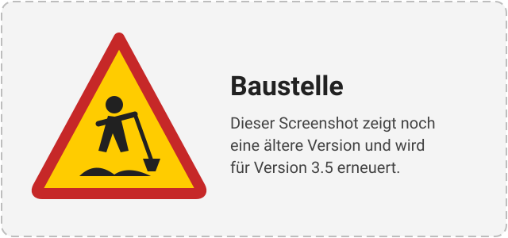
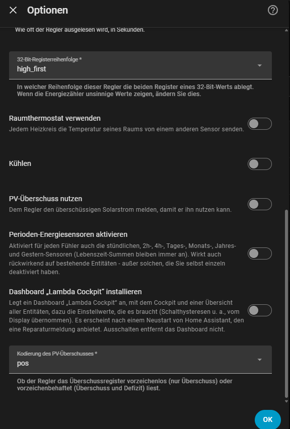

# Optionen der Integration („Konfigurieren“)

*Zuletzt geändert am 09.11.2026*

  

    
  

  

    
Nach der Einrichtung passen Sie das Verhalten der Integration in den Optionen an.

    <h2>Optionen öffnen</h2>

    <ol>
      <li><strong>Einstellungen</strong> → <strong>Geräte & Dienste</strong> → <strong>Lambda Heat Pumps</strong></li>
      <li>Beim Eintrag Ihrer Lambda auf <strong>Konfigurieren</strong> (Zahnrad) klicken</li>
    </ol>
    
Nach dem Speichern lädt sich die Integration automatisch neu.

  

!!! info "Firmware-Version, Adresse und Name stehen nicht hier"
    Firmware-Version, Host, Port, Modbus-Einheit und Name ändern Sie über **⋮ → Neu konfigurieren**, nicht über „Konfigurieren“. Details: [Firmware-Version ändern](firmware-wechsel.md).

## Der Dialog „Optionen“

### Minimale / Maximale Warmwassertemperatur

- **Standard:** 25 °C / 65 °C, einstellbar von 25 bis 65 °C.
- Legt fest, welchen Bereich die Klima-Entität **Warmwasser** für die Solltemperatur anbietet. Siehe [Warmwasser Solltemperatur Steuerung](warmwasser-solltemperatur.md).

### Minimale / Maximale Heizkreistemperatur

- **Standard:** 15 °C / 35 °C, einstellbar von 10 bis 40 °C.
- Legt fest, welchen Bereich die Klima-Entitäten **Heizkreis** und **Kühlkreis** für die Raum-Solltemperatur anbieten.

### Schrittweite Heizkreistemperatur

- **Standard:** 0,5 °C, einstellbar von 0,1 bis 2,0 °C.
- Schrittweite, in der die Solltemperatur an den Klima-Entitäten verstellt wird.

Ist ein Minimum nicht kleiner als das Maximum, lehnt der Dialog das Speichern ab: „Die minimale Temperatur muss unter der maximalen liegen.“

### Abfrageintervall

- **Standard:** 30 Sekunden, einstellbar von 10 bis 300 Sekunden.
- So oft liest die Integration die ganze Lambda aus. Unabhängig davon fragt sie alle 2 Sekunden den Betriebszustand der Wärmepumpen ab, damit kurze Kompressorstarts für die Taktungszähler nicht verloren gehen.

### 32-Bit-Registerreihenfolge

- **Auswahl:** `high_first` (höherwertiges Register zuerst) oder `low_first` (niederwertiges Register zuerst).
- **Vorauswahl:** die Reihenfolge der eingestellten Firmware (`high_first` bis V0.0.9-3K, `low_first` ab V0.0.10-3K).
- **Ändern** nur, wenn die akkumulierten Energiezähler trotz richtiger Firmware-Version unsinnige Werte zeigen, siehe [Falsche / keine Sensorwerte](../FAQ/falsche-keine-sensorwerte.md).
- Bei einem Firmwarewechsel über „Neu konfigurieren“ wird eine hier gewählte Reihenfolge zurückgesetzt; danach gilt die der neuen Firmware.

### Perioden-Energiesensoren aktivieren

- **Standard:** aus.
- Schaltet für jeden Zyklus-, Energie-, Wärme- und COP-Zähler zusätzlich alle Perioden-Sensoren frei: stündlich, 2 h, 4 h, täglich, monatlich, jährlich und „gestern“. Die Lebenszeit-Summe (`total`) ist davon nicht betroffen — sie ist immer an.
- Wirkt **rückwirkend**, auch auf bereits laufende Installationen: Wenn Sie den Schalter umlegen, werden alle betroffenen, bereits existierenden Entitäten automatisch aktiviert bzw. (beim Ausschalten) wieder deaktiviert. Eine Entität, die Sie selbst einzeln über **Entitäten** deaktiviert haben, lässt der Schalter in Ruhe.
- Speichern Sie die Optionen aus einem anderen Grund und lassen den Schalter, wie er ist, bleiben einzeln aktivierte Perioden-Sensoren aktiv (ab 3.7.0).
- Praktisch, wenn Sie das [Lambda-Energy-Dashboard](../Vorlagen/Lambda_energy_dashboard.md) nutzen möchten, ohne die 56 Perioden-Sensoren einzeln freizuschalten.

### Dashboard „Lambda Cockpit“ installieren

- **Standard:** aus. Neu ab Version 3.7.0.
- Legt das Dashboard **Lambda Cockpit** an: eine Übersicht der Wärmepumpe mit Warmwasser, Puffer, Heizkreis, Heizkurve, Schaltpunkten, Laufzeiten und Energie, dazu eine Liste aller Entitäten mit Erklärung.
- Nach **Absenden** erscheint unter **Einstellungen** → **Reparaturen** der Eintrag „Home Assistant neu starten, um das Lambda Cockpit anzuzeigen“. Öffnen und **OK** startet Home Assistant neu; danach steht das Dashboard in der Seitenleiste. Ist es nicht sofort zu sehen, die Seite im Browser neu laden.
- Mit dem Schalter entstehen zusätzlich die Einstellwerte für die Schaltpunkte (Hysteresen, Spreizung, Heizgrenze, maximale Temperaturen). Sie sind Kopien der Lambda-Einstellungen und werden einmal vom Display übernommen. Außerdem werden die Tageszähler eingeschaltet, die das Cockpit zeigt.
- **Ausschalten** entfernt das Dashboard und diese Einstellwerte wieder, ohne Neustart. Eigene Änderungen am Dashboard gehen dabei verloren.
- Details: [Lambda Cockpit](lambda-cockpit.md).

### Raumthermostat verwenden

- **Standard:** aus.
- Schickt jedem Heizkreis die Raumtemperatur eines Sensors aus Home Assistant. Nach **Absenden** folgt der Schritt **„Raumtemperatur“**, in dem Sie pro Heizkreis einen Temperatursensor wählen.
- Zusätzlich erscheinen pro Heizkreis die Zahlen-Entitäten **Raum Temperatur Offset** und **Raum Temperatur Faktor**.
- Details: [Raumthermometer](raumthermometer.md).

### Kühlen

- **Standard:** aus.
- Legt pro Heizkreis zusätzlich die Klima-Entität **Kühlkreis** an, mit der Sie die Raum-Solltemperatur für den Kühlbetrieb einstellen.
- Auch hier folgt der Schritt **„Raumtemperatur“**: Der Kühlkreis braucht denselben Ist-Wert wie die Heizkreis-Regelung.

### PV-Überschuss nutzen

- **Standard:** aus.
- Meldet der Lambda regelmäßig (alle 9 Sekunden) den überschüssigen Solarstrom. Nach **Absenden** folgt der Schritt **„PV-Überschuss“**, in dem Sie den **PV-Leistungssensor** wählen (W oder kW, wird automatisch umgerechnet).
- Details: [PV Überschuss Steuerung](pv_ueberschuss_steuerung.md).

### Kodierung des PV-Überschusses

| Wert | Bedeutung |
|---|---|
| `pos` (Standard) | Nur Überschuss, vorzeichenlos (UINT16, 0–65535 W). Negative Werte werden als 0 gesendet. |
| `neg` | Überschuss und Defizit, vorzeichenbehaftet (INT16, −32768–32767 W). |

Die Kodierung muss zur Einstellung des E-Managers an der Lambda passen. Der Wert wird in das Lambda-Register 102 geschrieben.

## Nächste Schritte

- [Raumthermometer](raumthermometer.md) einrichten
- [PV Überschuss Steuerung](pv_ueberschuss_steuerung.md) einrichten
- [Warmwasser Solltemperatur Steuerung](warmwasser-solltemperatur.md)
- [Energie- und Wärmeverbrauchsberechnung](Energieverbrauchsberechnung.md)
- [Lambda Cockpit](lambda-cockpit.md) installieren
