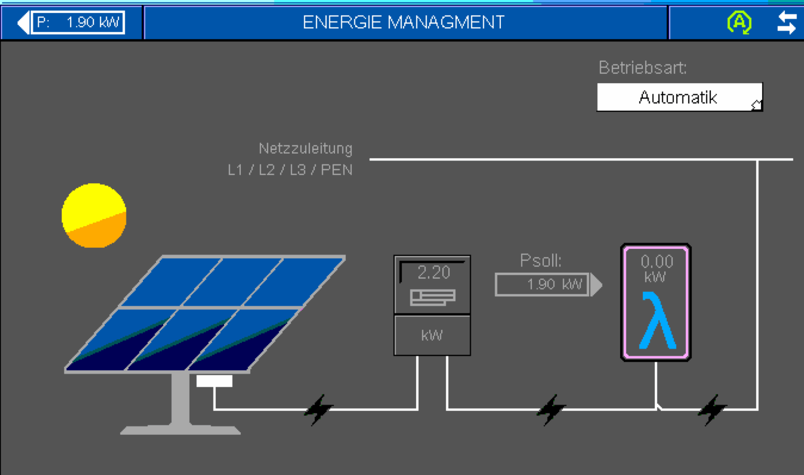

# PV Überschuss Steuerung

*Zuletzt geändert am 31.10.2026*

Die Lambda kann ihre Leistung erhöhen, wenn PV-Überschuss vorliegt. Dazu meldet die Integration der Lambda regelmäßig, wie viel Solarstrom gerade übrig ist. Die Lambda regelt danach selbst.

## So funktioniert es

- Sie wählen in den Optionen einen Sensor aus Home Assistant, der den PV-Überschuss in **W** oder **kW** liefert (kW wird automatisch in W umgerechnet).
- Die Integration schreibt diesen Wert **alle 9 Sekunden** in das Register 102 der Lambda (E-Manager, „aktuelle Leistung“).
- Die Lambda zeigt den Wert auf ihrer Seite **Energie-Management** an und erhöht ihre Leistung, wenn genug Überschuss vorhanden ist.

!!! warning "Die Lambda erwartet laufend Werte"
    Bekommt die Lambda einige Minuten lang keinen Wert, meldet der E-Manager einen Fehler (Fehler 6, „ungültiger Wert“).

    - Liefert der gewählte Sensor `unbekannt` oder `nicht verfügbar`, schreibt die Integration **nichts**. Fällt Ihre PV-Quelle länger aus, kommt es deshalb zu diesem Fehler. Ein Template-Sensor, der in diesem Fall `0` liefert, verhindert das.
    - Nutzen Sie die Funktion nicht mehr, schalten Sie sie **auch an der Lambda** ab, nicht nur in Home Assistant.

## Einrichtung in Home Assistant

1. **Einstellungen** → **Geräte & Dienste** → Lambda → **Konfigurieren**.
2. **PV-Überschuss nutzen** einschalten und bei **Kodierung des PV-Überschusses** die Variante wählen, die zur Lambda passt:
    - `pos`: nur Überschuss, 0 bis 65535 W. Negative Werte werden als 0 gesendet.
    - `neg`: Überschuss und Bezug, −32768 bis 32767 W.
3. **Absenden**. Im Schritt **„PV-Überschuss“** den **PV-Leistungssensor** wählen und erneut **Absenden**.

### Welcher Sensor?

Der Sensor soll den **Überschuss** zeigen, also die Leistung, die sonst ins Netz ginge, nicht die gesamte PV-Erzeugung.

- Liefert Ihr Zähler die Einspeisung als **negativen** Wert, bauen Sie einen Template-Sensor, der das Vorzeichen umdreht, oder nutzen Sie die Kodierung `neg`.
- Ein Beispiel aus einer laufenden Anlage: Einspeisung ins Netz, plus Ladeleistung der Hausbatterie, sobald deren Ladestand über einer Schwelle (z. B. 80 %) liegt; `0 W`, wenn die Quelle länger als 2 Minuten keine neuen Werte liefert.

## Einstellungen an der Lambda

An der Lambda muss der E-Manager auf Werte per Modbus eingestellt sein. Eine erfolgreich getestete Einstellung (EU10L, Firmware V1.0.4-3K):

| Einstellung | Wert |
|---|---|
| E-Meter-Typ | **Modbus Client** (nicht „Modbus EM300“) |
| Messpunkt | **E-Überschuss** (passend zur Kodierung `pos`) |
| Betriebsart | **Automatik**, wenn die Lambda den Überschuss nutzen soll (siehe unten) |

!!! note "Betriebsart Manuell oder Automatik"
    Der Überschuss kommt in beiden Betriebsarten an der Lambda an (Sensor `emgr_actual_power`). **Genutzt wird er aber nur in „Automatik“:** Nur dann berechnet die Lambda eine Sollleistung (`emgr_power_consumption_setpoint`, Psoll) und passt ihre Leistungsaufnahme an. In „Manuell“ bleiben Psoll und `emgr_actual_power_consumption` bei 0, und die Wärmepumpe läuft wie ohne Überschuss (gemessen an einer EU10L mit V1.0.4-3K).

    In „Automatik“ kann die Lambda zusätzlich die Temperaturen anheben (Handbuch: „PV Betrieb – Temperaturerhöhung“ für Heizkreis, Puffer und Warmwasser). Prüfen Sie diese Einstellungen an der Lambda, bevor Sie „Automatik“ wählen.

!!! warning "Messpunkt passend zum gemeldeten Wert"
    Die Integration meldet den Wert, den der Quellsensor liefert. Wählen Sie den Messpunkt so, dass er dazu passt: **E-Überschuss**, wenn der Wert nur den Überschuss enthält (ohne den Verbrauch der Wärmepumpe). Enthält der Wert den Verbrauch der Wärmepumpe (z. B. ein Netzzähler hinter der Wärmepumpe), rechnet die Lambda ihren eigenen Verbrauch heraus und sieht unter Umständen einen Überschuss, wo keiner ist ([#137](https://github.com/GuidoJeuken-6512/lambda_heat_pumps/issues/137)).

Danach ist der Überschuss auf der Seite Energie-Management der Lambda sichtbar:

## Prüfen

- **In Home Assistant:** Der Sensor `sensor.<name>_emgr_actual_power` („E-Manager Leistung“) zeigt den Wert, den die Lambda gerade gespeichert hat. `sensor.<name>_emgr_operating_state` und `sensor.<name>_emgr_error_number` zeigen Zustand und Fehler des E-Managers.
- **An der Lambda:** Seite Energie-Management.

Weitere Informationen: [Optionen des Config Flow](optionen-config-flow.md)
